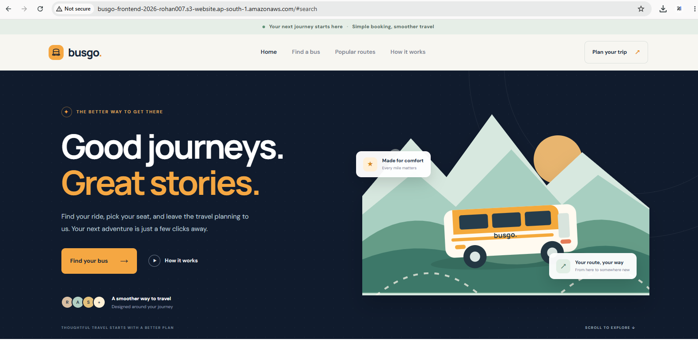
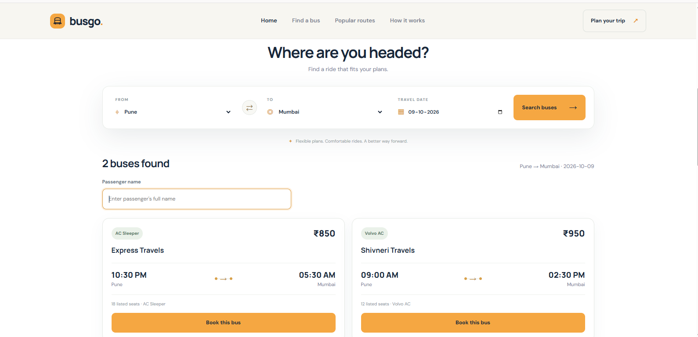
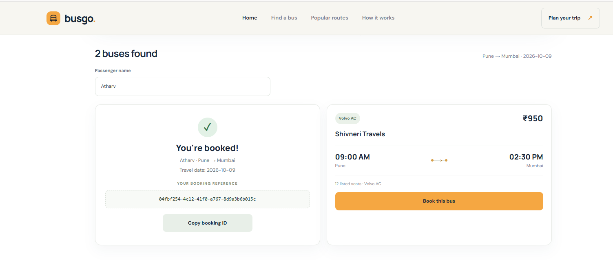
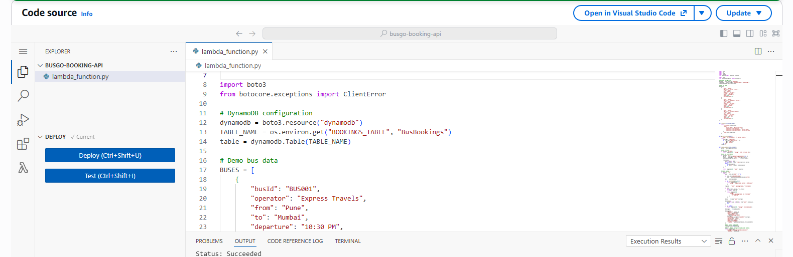
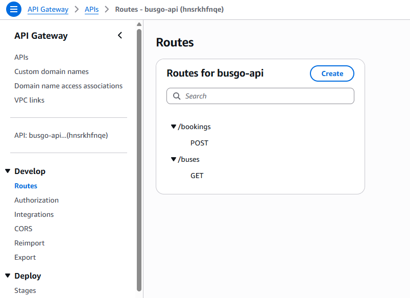
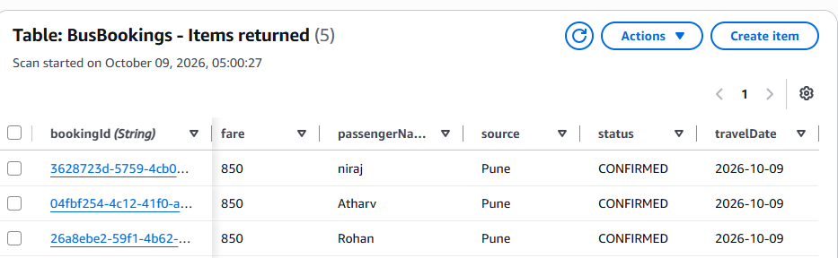
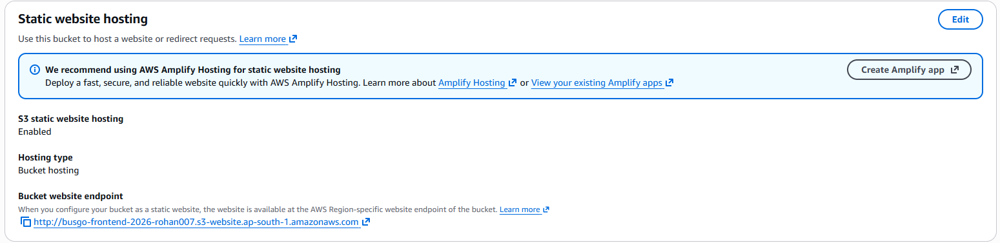

# BusGo — AWS Bus Booking Application

## 1. Project Overview

BusGo is a web-based bus booking application built using AWS services. Users can view available sample buses, enter passenger and travel details, and submit a booking request.

## 2. Project Objectives

* Host the website using Amazon S3 static website hosting.
* Expose backend endpoints using Amazon API Gateway.
* Process search and booking requests with AWS Lambda.
* Store booking records in Amazon DynamoDB.
* Demonstrate integration between frontend and serverless AWS services.

## 3. AWS Architecture

The application follows this request flow:

**User's Browser → Amazon S3 → API Gateway → AWS Lambda → Amazon DynamoDB**

* **Amazon S3:** Hosts the static website files.
* **Amazon API Gateway:** Exposes the bus search and booking API endpoints.
* **AWS Lambda:** Processes requests and booking logic.
* **Amazon DynamoDB:** Stores booking records in the `BusBookings` table.

## 4. Technology Stack

* Frontend: HTML, CSS, JavaScript
* Backend: Python on AWS Lambda
* API: Amazon API Gateway
* Database: Amazon DynamoDB
* Hosting: Amazon S3 static website hosting
* AWS Region: `ap-south-1` (Mumbai)

## 5. API Endpoints

Base URL:

`https://hnsrkhfnqe.execute-api.ap-south-1.amazonaws.com`

### Search buses

* Method: `GET`
* Path: `/buses`
* Purpose: Returns sample bus information.

### Create a booking

* Method: `POST`
* Path: `/bookings`
* Purpose: Validates booking details, generates a booking ID, and stores the booking in DynamoDB.

Required booking fields include `busId`, `passengerName`, and `travelDate`.

## 6. Database

* Table: `BusBookings`
* Partition key: `bookingId`
* Key type: String

The Lambda execution role requires permission to write booking records to the DynamoDB table.

## 7. Implementation Steps

1. Create the DynamoDB table.
2. Create and configure the Lambda function.
3. Configure API Gateway routes and integrations.
4. Configure the required IAM permissions and CORS settings.
5. Develop the frontend files: `index.html`, `style.css`, and `app.js`.
6. Upload the frontend files to an S3 bucket.
7. Enable static website hosting and configure public access appropriately for the demo.
8. Test bus search and booking creation.

## 8. Testing Results

Based on the project's reported tests:

* The S3-hosted homepage loaded successfully.
* Bus search returned sample bus results.
* Booking submission displayed a confirmation and booking ID.
* A booking record was previously observed in DynamoDB.

These results reflect the tests reported during development; they are not an independent AWS audit.

## 9. Limitations

* Bus information is sample/demo data.
* Search results are not connected to a live bus operator inventory.
* Seat availability is not reserved atomically.
* Payment processing, authentication, cancellation, and notifications are not implemented.
* S3 website endpoints use HTTP; HTTPS can be added with CloudFront.

## 10. Future Enhancements

* Integrate live bus schedules and seat availability.
* Add user authentication.
* Add secure payment processing.
* Implement booking cancellation and notifications.
* Add CloudFront for HTTPS delivery.
* Add monitoring, logging, and automated tests.

## 11. Conclusion

BusGo demonstrates a serverless web application using Amazon S3, API Gateway, AWS Lambda, and DynamoDB. The implemented demo flow supports bus search and booking creation, providing a foundation for future improvements.

## 12. Deployment Details

* AWS Region: `ap-south-1`
* Lambda function: `busgo-booking-api`
* DynamoDB table: `BusBookings`
* API Gateway base URL: `https://hnsrkhfnqe.execute-api.ap-south-1.amazonaws.com`
* S3 bucket name: Add your actual bucket name.
* Website endpoint: Add your actual S3 website endpoint.

## 13. Evidence to Include

1. The live BusGo homepage.

2. Bus search results.

3. Booking confirmation and booking ID.

4. The Lambda function and code editor.

5. API Gateway routes.

6. The DynamoDB table and a booking item.

7. S3 static website hosting configuration.

